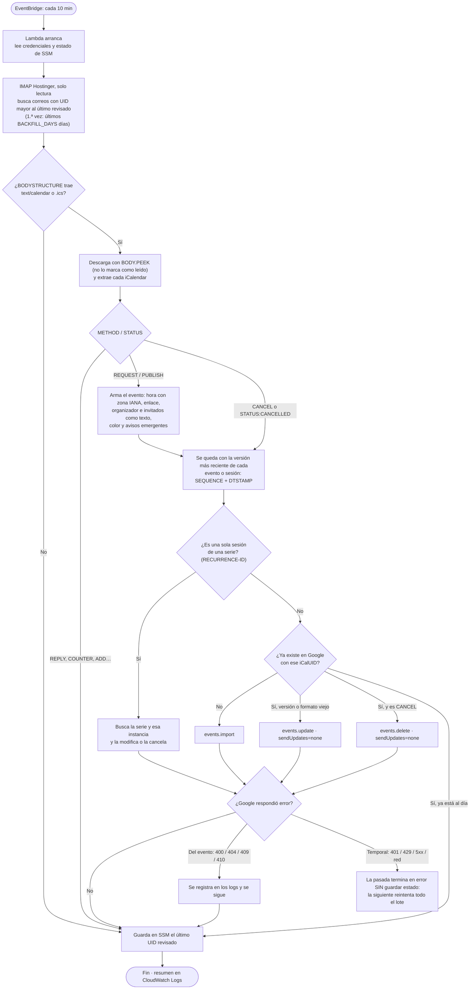

# mail2cal

Copia a **Google Calendar** las invitaciones a reuniones que llegan a un buzón IMAP
(pensado para el correo empresarial de Hostinger). Corre en **AWS Lambda** cada 10
minutos, así que no depende de que tu máquina esté encendida.

- Lee solo los correos nuevos y descarga únicamente los que traen `.ics` / `text/calendar`.
- Abre el buzón **en solo lectura**: no marca nada como leído ni mueve correos.
- Crea el evento, lo **actualiza** si el organizador lo cambia y lo **borra** si lo cancela.
  En las series recurrentes también aplica los cambios y cancelaciones de una sola sesión.
- Funciona con invitaciones de Outlook/Teams (traduce sus zonas horarias de Windows),
  Google Calendar, Zoom, etc., y pone el enlace de la reunión al principio de la descripción.
- Organizador e invitados quedan escritos en la descripción. No se pasan a Google como
  participantes, así que Google nunca les escribe aunque edites o borres el evento.
- Color propio para los eventos importados (`EVENT_COLOR_ID`) y avisos **solo en la app**,
  sin correo: por defecto 30 y 1 minutos antes (`REMINDER_MINUTES`).
- No envía nada a nadie: no responde invitaciones ni notifica a los asistentes.

## 1. Preparar Google (una sola vez, unos 10 min)

1. Entra a <https://console.cloud.google.com/> con tu cuenta **personal** y crea un proyecto (p. ej. `mail2cal`).
2. **APIs y servicios → Biblioteca** → busca **Google Calendar API** → **Habilitar**.
3. **Google Auth Platform** (antes "Pantalla de consentimiento de OAuth"):
   - *Branding*: nombre de la app (`mail2cal`) y tu correo.
   - *Público (Audience)*: **Externo**, y luego **Publicar app → En producción**.
     > ⚠️ Importante: si la dejas en modo *Testing*, Google invalida el token cada 7 días
     > y la sincronización deja de funcionar. Para uso personal no hace falta la verificación de Google.
4. **Clientes → Crear cliente** → tipo **App de escritorio** → copia el *ID de cliente* y el *secreto*.
5. (Recomendado) En Google Calendar crea un calendario aparte, p. ej. **Trabajo**
   (*Otros calendarios → + → Crear calendario*). En su configuración, en *Integrar el calendario*,
   copia el **ID del calendario** (`...@group.calendar.google.com`). Así los eventos importados
   quedan separados y puedes ocultarlos o borrarlos de una vez.

## 2. Configurar y probar en local

```bash
cd mail2cal
python3 -m venv .venv && .venv/bin/pip install -r requirements-dev.txt
cp .env.example .env        # rellena IMAP_*, GOOGLE_CLIENT_ID/SECRET, GOOGLE_CALENDAR_ID, DEFAULT_TIMEZONE
.venv/bin/python scripts/get_google_token.py    # abre el navegador y guarda GOOGLE_REFRESH_TOKEN en .env
```

Al autorizar verás *"Google no ha verificado esta app"*: es tu propia app, así que entra en
**Configuración avanzada → Ir a mail2cal**.

```bash
.venv/bin/python -m mail2cal run --dry-run   # lee el correo y muestra qué haría, sin tocar Google
.venv/bin/python -m mail2cal run             # sincroniza de verdad
.venv/bin/python -m pytest                   # pruebas
```

Para ver cómo se convertiría una invitación concreta, descárgala desde Roundcube
(*Más → Descargar (.eml)*) y ejecuta `.venv/bin/python -m mail2cal parse invitacion.eml`.

La primera ejecución revisa los últimos `BACKFILL_DAYS` días (30 por defecto). Las siguientes
solo revisan lo nuevo. Volver a procesar una invitación no crea duplicados.

## 3. Desplegar en AWS Lambda

Necesitas una cuenta de AWS y el AWS CLI configurado (`aws configure` o `aws login`) con
permisos para IAM, Lambda, SSM, EventBridge y CloudWatch Logs.

```bash
./deploy.sh
```

El script crea o actualiza todo, y al final ejecuta una pasada de prueba:

| Recurso | Para qué |
|---|---|
| Función Lambda `mail2cal` (Python 3.13, arm64) | el sincronizador |
| Regla de EventBridge `mail2cal-schedule` | la ejecuta cada 10 min (`SCHEDULE` en `.env`) |
| Parámetro SSM `/mail2cal/secrets` (SecureString) | contraseña IMAP y credenciales de Google, cifradas |
| Parámetro SSM `/mail2cal/state` | último correo procesado de cada carpeta |
| Rol IAM `mail2cal-lambda-role` | solo puede escribir logs y leer/escribir `/mail2cal/*` |
| Logs `/aws/lambda/mail2cal` | se guardan 14 días |

Si cambias el código o el `.env`, vuelve a ejecutar `./deploy.sh`. Para quitarlo todo:
`./deploy.sh --destroy`.

```bash
aws logs tail /aws/lambda/mail2cal --follow                 # ver qué está haciendo
aws lambda invoke --function-name mail2cal /dev/stdout       # forzar una pasada ahora
```

**Costo:** ~0 USD/mes; todo cabe en el nivel gratuito. Sin nivel gratuito serían unos 0,05–0,10 USD/mes.
Ver el diagrama de la arquitectura y el desglose en [docs/arquitectura.md](docs/arquitectura.md).

## Cosas a tener en cuenta

- **Responder la invitación** (aceptar/rechazar) se sigue haciendo desde el correo de la empresa;
  mail2cal solo copia el evento a tu calendario.
- Si editas un evento importado en Google y luego el organizador lo actualiza, se aplican los cambios
  del organizador.
- Igual que Gmail, se agrega cualquier invitación que llegue al buzón, venga de quien venga.
- Si algo falla de forma temporal (Google o IMAP caídos, token inválido), la pasada termina en error,
  no se avanza el estado y la siguiente reintenta. Si el error es `invalid_grant`, vuelve a ejecutar
  `scripts/get_google_token.py` y `./deploy.sh`. Si quieres un aviso por correo cuando falle, crea una
  alarma de CloudWatch sobre la métrica `Errors` de la función.
- Si las invitaciones te llegan a otra carpeta (por un filtro o al spam), agrégala en `IMAP_FOLDERS`.
- Si cambias `EVENT_COLOR_ID` o `REMINDER_MINUTES`, los eventos se actualizan la próxima vez que se
  procesa su invitación. Para aplicarlo ya a los eventos de los últimos `BACKFILL_DAYS` días, despliega y
  borra el estado: `aws ssm delete-parameter --name /mail2cal/state`. No se duplica nada.

## Estructura

```
mail2cal/
  config.py       configuración (.env en local; variables de entorno + SSM en Lambda)
  imap_source.py  lectura IMAP en solo lectura y extracción de los .ics
  ics_convert.py  iCalendar (REQUEST/CANCEL) -> evento de Google Calendar
  gcal.py         cliente mínimo de la API de Google Calendar (sin dependencias)
  sync.py         una pasada completa: correo -> invitaciones -> calendario
  state.py        estado en archivo local o en SSM
lambda_function.py         punto de entrada de Lambda
scripts/get_google_token.py  obtener el refresh token de Google
deploy.sh                    despliegue y desinstalación en AWS
```

## Flujo de una pasada



