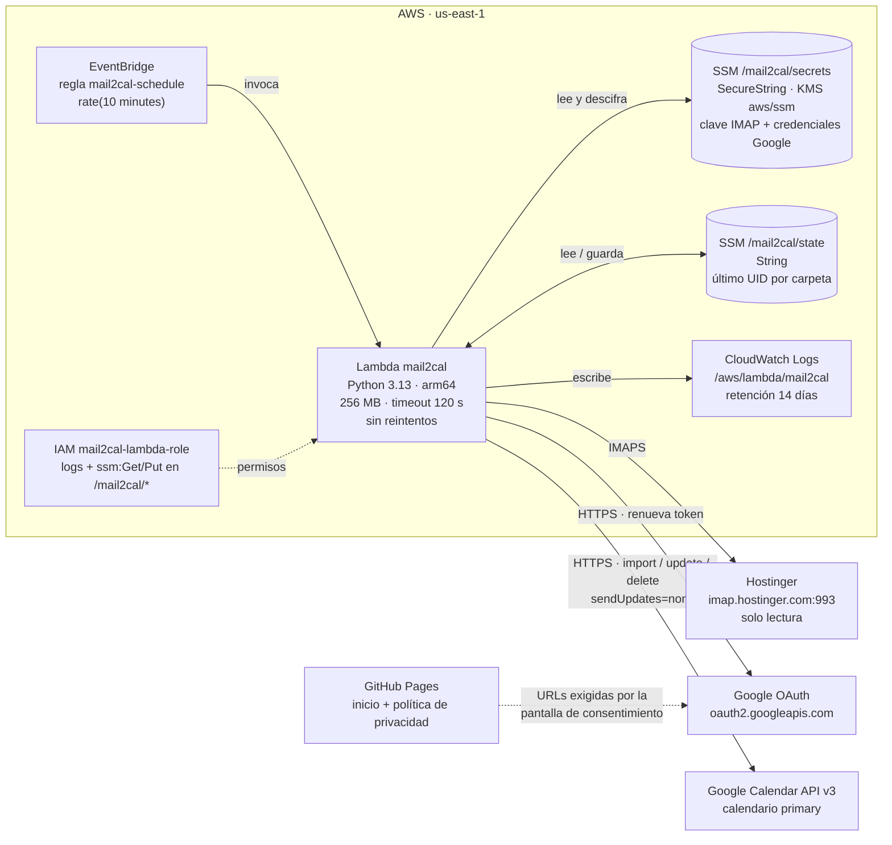

# Arquitectura desplegada en AWS

Lo que crea `./deploy.sh` y con qué servicios externos habla.

## Costos aproximados (mensuales)

Base de cálculo: una ejecución cada 10 minutos ≈ **4.320 ejecuciones al mes**. En los logs, una
pasada sin correos nuevos tarda **1–2 s** y usa **~100 MB**; la más lenta (arranque en frío) ~5 s.

| Servicio | Uso estimado al mes | Nivel gratuito | Costo con nivel gratuito | Costo sin nivel gratuito |
|---|---|---|---|---|
| Lambda: solicitudes | 4.320 | 1.000.000 al mes, permanente | 0 USD | ~0,001 USD |
| Lambda: cómputo (256 MB, arm64) | 2.200–5.400 GB-s | 400.000 GB-s al mes, permanente | 0 USD | 0,03–0,07 USD |
| EventBridge (regla programada) | 4.320 invocaciones | Los eventos programados no se cobran | 0 USD | 0 USD |
| SSM Parameter Store (2 parámetros estándar) | ~8.600 lecturas/escrituras | Nivel estándar gratuito | 0 USD | 0 USD |
| KMS (clave administrada `aws/ssm`) | ~4.320 descifrados | 20.000 solicitudes al mes | 0 USD | ~0,01 USD |
| CloudWatch Logs | ~5–10 MB | 5 GB al mes | 0 USD | < 0,01 USD |
| Transferencia de datos salientes | < 50 MB | 100 GB al mes | 0 USD | < 0,01 USD |
| IAM | 1 rol | Siempre gratis | 0 USD | 0 USD |
| **Total AWS** | | | **0 USD** | **~0,05–0,10 USD** |
| Google Calendar API + OAuth | unas pocas llamadas por pasada | 1.000.000 consultas al día | 0 USD | 0 USD |
| GitHub Pages | 2 páginas estáticas | Incluido en tu plan | 0 USD | 0 USD |

Precios de referencia de us-east-1 (Lambda arm64: 0,0000133334 USD por GB-s y 0,20 USD por millón
de solicitudes; KMS: 0,03 USD por 10.000 solicitudes; CloudWatch Logs: 0,50 USD por GB ingerido;
salida a internet: 0,09 USD por GB). Los precios pueden cambiar: revisa la
[calculadora de AWS](https://calculator.aws/) o *Billing → Bills* en la consola.

### Qué haría subir el costo

- **Ejecutar más seguido.** `rate(1 minute)` multiplica por 10 las ejecuciones; aun así sigue dentro
  del nivel gratuito (~43.000 al mes).
- **Buzones enormes en la primera pasada.** Solo afecta a la duración de esa pasada (máx. 120 s).
- **Bucles de error.** Si una pasada falla, la siguiente reintenta 10 minutos después, sin reintentos
  extra. Un error continuo cuesta lo mismo que el funcionamiento normal.

Para recibir un aviso si alguna vez hay un cobro, crea un presupuesto en *Billing → Budgets*
(por ejemplo, 1 USD al mes con alerta por correo).
